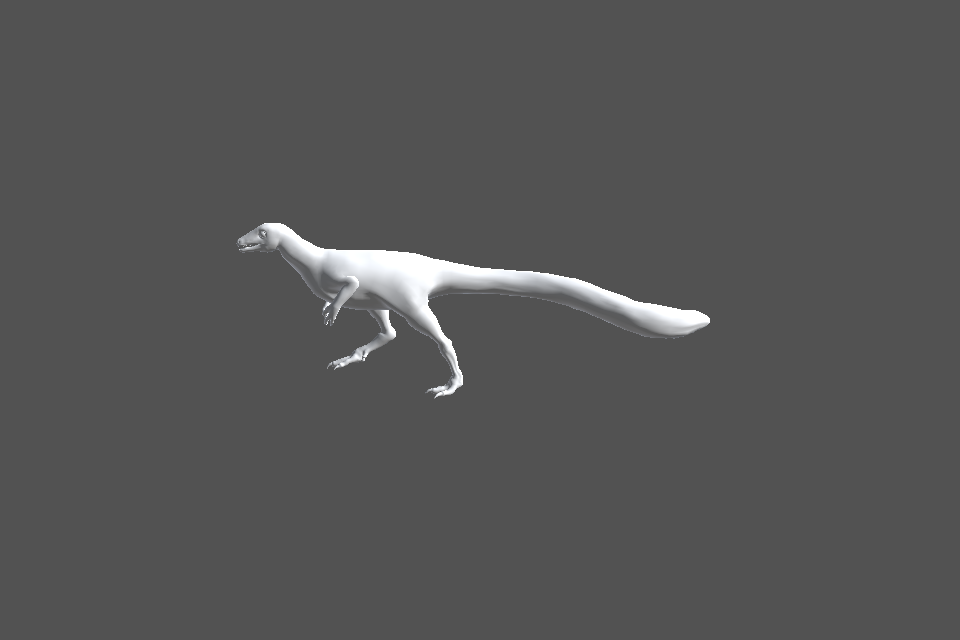
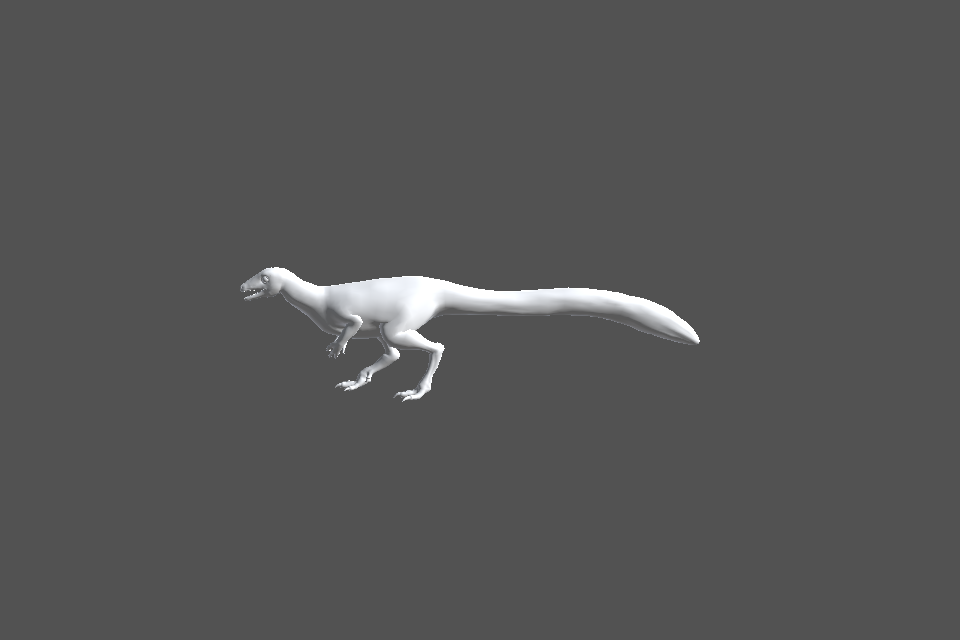
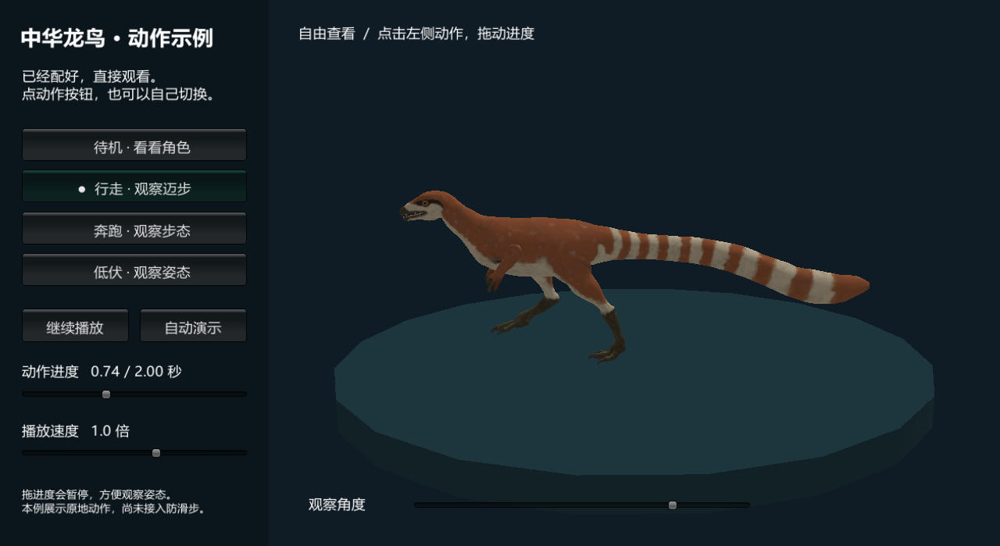

# 角色剧情编排工具开发记录：2026-09-11

阶段状态：G0 部分完成，G1 数学与动画求值基础已实现；没有宣布 G0/G1 整体通过。

## 本次交付

- Runtime：角色与动作配置、输入校验、只读路径弧长和绝对时间求值、独占动画采样及状态恢复。
- Editor：开发工作台、只读素材检查、动作库切换、独立模型预览、候选配置和报告生成。
- Tests：23 项 EditMode 用例，覆盖数值边界、时间跳转、倍率冲突、控制权、资源释放和真实素材采样。
- 宿主工程：创建源素材目录，接入用户提供的模型和动画，新增候选配置与报告。

## 实际环境

插件：`E:/X/CodeProjects/AIBuilder`；宿主：`D:/Unity Project/AIBuilderTest`。

实际文件显示 Unity `2022.3.62f3`、URP `14.0.12`、Timeline `1.7.7`。未修改现有宿主的包版本、源 FBX 导入设置、业务场景或 Prefab。

隔离验证工程：`E:/X/Validation/CreatureStageValidation_20260911`。源码通过本地包引用加载；素材副本保留原 GUID。测试后核对 38 个 FBX 和对应 meta，均与宿主源文件哈希一致。生成配置通过原 GUID 引用宿主素材。

## 素材检查结果

- 模型有 76 个 Transform 节点；导入类型 Generic，骨架未优化隐藏。
- 37 个动画均为 Generic、30 fps，导入循环标记均为 False；不能因此推断素材本身是否可循环。
- 全部动画对模型的骨架路径缺失数和 Transform 动画绑定目标缺失数均为 0。轴向、参考姿态与蒙皮兼容仍需专项检查。
- 左右完整腿链已定位：Thigh → Calf → HorseLink → Foot；未删除或重挂骨骼。
- 左脚三条 ToeNub、右前肢三条 FingerNub 存在负缩放告警。它们是原素材数据，未进行清零或修复，尚需确认是否参与蒙皮及接触计算。
- 模型根没有 Animator，独立预览副本会添加 Animator；未向源 FBX 写入组件。
- 动作文件包含起步、起跑、停止、低伏和转身候选，但当前名称只是索引，所有动作仍标记为待分类、未校准。

生成资产：`D:/Unity Project/AIBuilderTest/Assets/CreatureStage/Generated/Intake_20260911_01`。

其中 `ActorProfile.asset` 保存候选骨架绑定；37 个 `Action_*.asset` 保存源 Clip 引用；`IntakeReport.md` 保存完整逐素材曲线报告。运动来源、步幅和接触区间尚未批准。

## 验证证据

- Unity EditMode：23/23 通过，0 失败；XML 保存于本目录 `CreatureStageEvidence/20260911/editmode.xml`。
- 真实素材用例遍历 37 个动画，在模型副本上执行 37% → 90% → 0 → 37% 的采样；37 个动画均产生实际姿态变化，重复采样结果在测试容差内一致。
- 姿态重现用例的局部位置容差为 0.00001 米、旋转容差为 0.1 度，只用于本次求值一致性验证，不是防滑步或艺术质量门槛。
- 隔离工程使用真实 Unity 图形设备生成 idle、walk、run、difu 四张预览。已检查 walk 与 difu 图像：模型完整进入画面，动作姿态不同。图片使用导入默认材质，没有做最终贴图和材质验收。
- 最新预览渲染批处理编译并成功退出。打开中的宿主 Editor 曾保留较早 DLL；尚未将宿主当前窗口操作记作通过。

本次没有进行 Player 构建、头显运行、防滑步、地形接触、HorseLink IK 或完整剧情验收。

## 后续实施顺序

1. 核对源素材蒙皮与负缩放末端节点，确认运动提取节点和模型正向。
2. 确认动作类型与循环区间，录入接触标记、步幅和转角数据，保留原始身体起伏。
3. 在匀速数学原型上增加非线性距离曲线、起停阶段、接触相位和路径合法性检查。
4. 实现接触锚点与 HorseLink 求解，用平地、缓坡、转身和低伏实验确认质量范围。
5. G1 通过后进入完整 Timeline 编排、烘焙、事件和多角色功能。

## 补充：可直接运行的入门示例

新增宿主场景 `Assets/CreatureStage/Examples/SinosauropteryxDemo/中华龙鸟_入门示例.unity`，也可从 `Tools > AIBuilder > 角色剧情 > 打开中华龙鸟示例` 打开。

已配置中华龙鸟副本、颜色贴图、展示台、相机与中文控制面板。进入 Play Mode 后每 4 秒轮播待机、行走、奔跑、低伏；支持手动切换、暂停、进度拖动、播放速度及观察角度。示例不包含路径运动、脚锁或动作过渡。

隔离 Unity 工程加载宿主 URP 配置，重新打开已保存场景并进入 Play Mode，验证了自动轮播、手动切换、暂停、Seek、重复姿态以及禁用/启用后的会话释放。完成实际 Game 画面截图复核，随后将同 GUID 的示例资产复制回宿主，复制哈希一致。源 FBX、动画、贴图与业务场景未改动。

运行检查摘要：`CreatureStageEvidence/20260911/demo-smoke.txt`。

## 场景编排追加交付

已接入 Export.fbx 独立场景实例，新增 Scene 路线/停留点编辑、15 段 Timeline 动作编排和 44 秒可编辑示例。最终回归 30/30 通过，真实素材的编辑撤销、保存重开、Play 播放及两张截图检查通过。示例已复制到宿主 StoryEditing 目录。详细入口、限制和证据见 CREATURE_STAGE_SCENE_EDITING.md 与 CreatureStageEvidence/20260911/StoryEditing。尚未实现动作混合和足部防滑。

## 速度、衔接与白模更新修复

当前 44 个动画 Clip 按 FBX 名称命名，保留原动画引用。实现移动/动画速度积分曲线、平均速度换算时长、缓起缓停预设、入场姿态和朝向混合。新增 7 个素材在隔离验证同步中产生的 GUID 差异已按宿主原始导入日志恢复，最终 88 个 FBX/meta 与验证副本哈希一致。回归 34/34 通过。新版白模地面 4→9 导致原碰撞器引用失效；增加自动重新绑定、地面缓存失效检测、始终可见的 Scene 辅助线与失效提示。宿主当前 5 条路线已修复并保存，现场确认绿色路线恢复，保留用户控制点。证据见 CreatureStageEvidence/20260911/SpeedAndGround。
